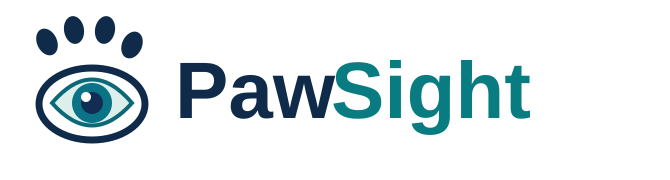
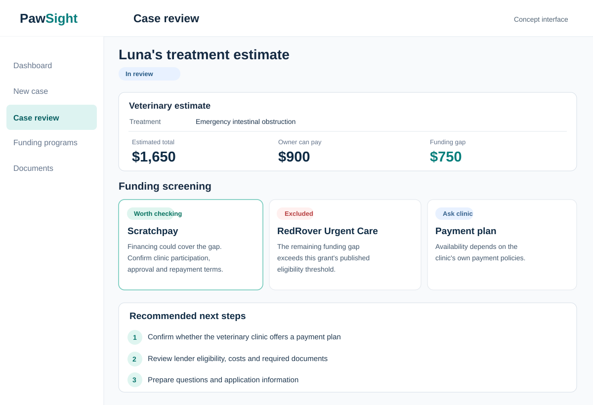

# PawSight

**Know which financial options fit your veterinary bill, and what to do next.**

**Judge's Choice Award, Most Innovative Track**  
UW-Madison Tech Exploration Lab Demo Night | November 19, 2026

Chaewon Yoon | Solo founder

## The problem

A pet owner can find financial assistance online and still be unable to use it. Grants have eligibility limits. Financing depends on approval, clinic participation, and repayment terms. A search result rarely explains what those conditions mean for one particular veterinary bill.

The scale is substantial. In a 2025 PetSmart Charities-Gallup study, **52% of U.S. dog and cat owners** reported skipping or declining needed veterinary care. Among owners who declined care because of cost, **73%** said they were not offered a lower-cost alternative. [Read the study](https://news.gallup.com/poll/659057/pet-owners-skipped-declined-veterinary-care.aspx). The U.S. veterinary care and related products market generated **$41 billion in sales in 2025**, according to [APPA](https://americanpetproducts.org/industry-trends-and-stats).

## What PawSight does

**PawSight is an AI-assisted financial navigation concept for veterinary care.** It starts with a treatment estimate and the owner's available budget, then helps make sense of potential funding options.

1. **Understand the bill.** Extract the treatment details, total amount, and remaining funding gap.
2. **Check the options.** Compare the case with published grant conditions, financing terms, and clinic-specific questions.
3. **Make a plan.** Explain relevant options and exclusions, flag what still needs confirmation, and prepare the owner's next steps.

### One example

A pet owner receives a **$1,650** estimate and can pay **$900**, leaving **$750**.

- **RedRover Urgent Care:** The program's published rules exclude cases where $500 or more is still needed for treatment to begin or continue. It is not a match for this funding gap.
- **Scratchpay:** Its published financing range includes the amount needed, but the owner must confirm that the clinic participates and review eligibility, approval, and repayment terms.
- **Clinic payment plan:** Worth asking about directly, since availability depends on the practice.

A generic resource list presents possibilities. PawSight is designed to explain the differences and organize the next action. See the [product workflow](docs/product-workflow.md).

## What I learned from customers

Customer discovery included **30 pet-owner surveys, four follow-up owner interviews, and one interview with veterinary staff**.

| Finding | Responses |
|---|---:|
| Faced difficulty affording veterinary care | 19 of 30 |
| Had searched for financial assistance | 16 of 30 |
| Among those who searched, struggled to determine eligibility | 11 of 16 |
| Among those who searched, abandoned at least one application | 7 of 16 |

The useful distinction was between **finding assistance** and **knowing whether it can actually help**. That insight shifted PawSight's focus from veterinary cost prediction to funding decisions, eligibility, and next steps.

These figures describe an early customer-discovery sample. The [discovery summary](docs/customer-discovery.md) covers the questions behind the product direction.

## How it fits the market

Existing services address different parts of veterinary affordability:

- **Financing:** [Scratchpay](https://scratchpay.com/) and [CareCredit](https://www.carecredit.com/) help owners pay over time.
- **Grants and fundraising:** [RedRover](https://redrover.org/relief/urgent-care-grants/) and [Waggle](https://www.waggle.org/) help qualifying cases access or raise funds.
- **Funding navigation:** [Help My Pet](https://helpmypet.us/pay-for-care/) and [Vet Bill Help Finder](https://www.vetbillhelpfinder.com/) already offer assistance guidance and eligibility information.
- **Bill analysis:** [FareVet](https://www.farevet.com/) helps people analyze veterinary costs and estimates.

PawSight's focus is **the decision that follows the estimate**: combining bill details, funding conditions, explanations, and application steps in one workflow. [See the competitor analysis](docs/competitive-landscape.md).

## Concept interface

*Concept interface showing how a PawSight case review could work. This is a static design visualization.*

## Demo Night and project materials

PawSight was presented at **UW-Madison Tech Exploration Lab Demo Night** on November 19, 2026, in the **Early Idea, Poster and Concept Only** format, and received the **Judge's Choice Award in the Most Innovative track**.

- [Demo Night record](docs/demo-night-2026.md)
- [Poster content](docs/poster-content.md)
- [Prepared three-minute pitch](docs/prepared-pitch.md)
- [Customer discovery](docs/customer-discovery.md)
- [Competitor comparison](docs/competitive-landscape.md)
- [Product workflow](docs/product-workflow.md)
- [Validation plan](docs/validation-roadmap.md)
- [Research sources](docs/sources.md)

## Next milestone

PawSight is at the concept and customer-discovery stage. The next study will compare its case-screening approach with existing ways of finding assistance, using the same veterinary scenarios. The key measures are **correct eligibility decisions, time to a usable next step, and clarity of explanations**.

## Contact

**Chaewon Yoon**  
`cyoon42@wisc.edu`